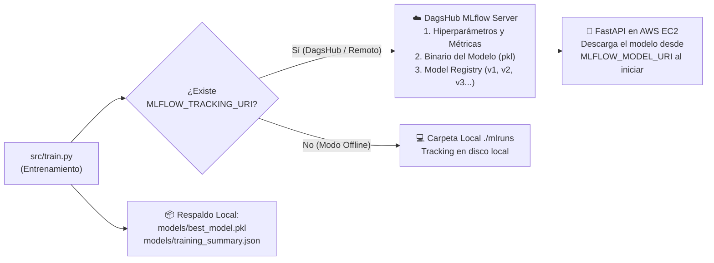
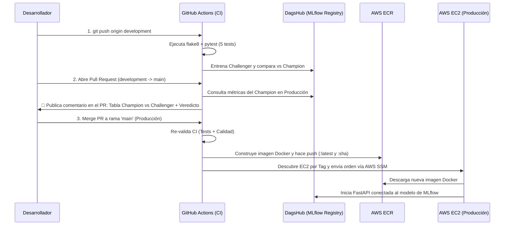

# 🚀 Guía Operativa de Despliegue, Entornos y Flujo CI/CD (MLOps)

Este documento detalla cómo operar la infraestructura en AWS con **Terraform**, cómo funciona el **entorno de desarrollo local**, hacia dónde viajan los experimentos y modelos de **MLflow**, y qué sucede automáticamente en cada etapa de **GitHub Actions** (`development`, `Pull Request` y `main`).

---

## 1. Gestión de Infraestructura en AWS (Terraform y Script de Control)

La infraestructura en la nube está definida como código en [`terraform/main.tf`](terraform/main.tf) y aprovisiona recursos 100% dentro de la **Capa Gratuita (AWS Free Tier)** en la región `us-east-1`:
- **Amazon EC2 (`t3.micro`):** Servidor Ubuntu 22.04 LTS con Docker y AWS SSM preinstalados.
- **Amazon ECR (`mlops-churn-poc-api`):** Registro privado de imágenes Docker con política de retención automática.
- **Amazon S3 (`mlops-churn-poc-mlflow-artifacts-*`):** Bucket cifrado (AES-256) y versionado para artefactos de modelos.
- **AWS IAM & Security Group:** Rol de mínimo privilegio (acceso a ECR, S3 y Systems Manager sin llaves estáticas en el servidor) y firewall para puertos `80` y `8000`.

### Opción A: Uso del Script Automatizado (`aws-control.ps1`) — *Recomendado*

En la raíz del proyecto cuentas con [`aws-control.ps1`](aws-control.ps1), que administra el ciclo de vida completo **sin que tengas que actualizar nunca los Secrets de GitHub**:

| Acción | Comando en PowerShell | ¿Qué hace por detrás? | Impacto en Costos / Estado |
| :--- | :--- | :--- | :--- |
| **Consultar Estado** | `.\aws-control.ps1 status` | Consulta en AWS el estado de la instancia EC2 e imprime su IP pública y URLs de `/docs` y `/health`. | Solo lectura. |
| **Levantar Todo (Crear)** | `.\aws-control.ps1 up` | Ejecuta `terraform init` y `terraform apply -auto-approve` dentro de `terraform/`. | Crea los 12 recursos en AWS (~45 seg). |
| **Pausar (Dormir EC2)** | `.\aws-control.ps1 stop` | Ejecuta `aws ec2 stop-instances`. Apaga la máquina virtual pero **conserva el disco y el contenedor Docker**. | **No consume horas de cómputo EC2**. Prende en 15 segundos. |
| **Reanudar (Despertar EC2)** | `.\aws-control.ps1 start` | Ejecuta `aws ec2 start-instances`. Al arrancar Ubuntu, Docker levanta la API automáticamente (`--restart always`). | Vuelve a estar online inmediatamente sin correr CI/CD. |
| **Destruir Todo ($0)** | `.\aws-control.ps1 down` | Ejecuta `terraform destroy -auto-approve`. Vacía el ECR/S3 y elimina todos los recursos de la cuenta AWS. | **Costo $0 absoluto** (elimina instancia, EBS, S3, ECR, IAM, SG). |

> [!TIP]
> **¿Por qué no necesitas actualizar `EC2_INSTANCE_ID` en GitHub Secrets al destruir y recrear?**
> Porque el workflow [`.github/workflows/mlops-pipeline.yml`](.github/workflows/mlops-pipeline.yml) incluye **autodescubrimiento por etiqueta**: consulta a la API de AWS por la instancia en estado `running` que tenga el tag `Name=mlops-churn-poc-api-server` asignado por Terraform.

### Opción B: Comandos Manuales de Terraform

Si prefieres ejecutar Terraform manualmente desde la carpeta `terraform/`:

```powershell
cd terraform

# 1. Inicializar providers (solo la primera vez)
terraform init

# 2. Ver el plan de ejecución antes de aplicar cambios
terraform plan

# 3. Crear o actualizar la infraestructura en AWS
terraform apply

# 4. Destruir toda la infraestructura cuando no se utilice
terraform destroy
```

---

## 2. Cómo Funciona el Entorno de Desarrollo Local

El entorno de desarrollo permite entrenar modelos, registrar experimentos y levantar la API de inferencia en tu propia máquina antes de subir cambios al repositorio.

### Configuración inicial
1. **Entorno virtual e instalación:**
   ```powershell
   python -m venv .venv
   .\.venv\Scripts\Activate.ps1
   pip install -r requirements.txt
   ```
2. **Variables de entorno (`.env`):**
   Tanto [`src/train.py`](src/train.py) como [`src/app.py`](src/app.py) cargan automáticamente el archivo `.env` en la raíz mediante `python-dotenv`:
   ```env
   MLFLOW_TRACKING_URI=https://dagshub.com/<TU_USUARIO>/<TU_REPO>.mlflow
   MLFLOW_TRACKING_USERNAME=<TU_USUARIO>
   MLFLOW_TRACKING_PASSWORD=<TU_TOKEN_DAGSHUB>
   MLFLOW_MODEL_URI=models:/customer_churn_model/1
   ```

### Comandos del ciclo de desarrollo
- **Entrenar modelos y registrar en MLflow:**
  ```powershell
  python -m src.train
  ```
- **Generar reporte comparativo Champion vs. Challenger:**
  ```powershell
  python -m src.compare_models
  ```
- **Probar el microservicio FastAPI localmente:**
  ```powershell
  uvicorn src.app:app --reload --port 8000
  ```
  Accede a `http://localhost:8000/docs` para probar predicciones interactivas desde Swagger UI.
- **Ejecutar Linter y Tests Unitarios (igual que en CI):**
  ```powershell
  flake8 src tests
  pytest tests/ -v
  ```

---

## 3. ¿A Dónde Sube los Datos y Modelos MLflow?

El script [`src/train.py`](src/train.py) soporta una arquitectura híbrida controlada por la variable `MLFLOW_TRACKING_URI`:



1. **Tracking de Experimentos (`customer-churn-prediction`):**
   - Cada vez que corres `python -m src.train`, se entrenan los modelos candidatos (`Logistic_Regression` y `Random_Forest`).
   - Se suben al servidor MLflow en **DagsHub** (o a `./mlruns` si trabajas sin conexión):
     - **Parámetros:** `n_estimators`, `max_depth`, `C`, `scaler`, tamaño de train/test.
     - **Métricas:** `f1_score`, `roc_auc`, `accuracy`, `precision`, `recall`.
     - **Artefactos:** El pipeline serializado de Scikit-Learn (`model.pkl`), `conda.yaml`, `requirements.txt` y ejemplos de entrada (`input_example.json`).
2. **Model Registry (`customer_churn_model`):**
   - El algoritmo ganador del entrenamiento (mayor `f1_score`) se registra automáticamente como una **nueva versión** en el **MLflow Model Registry** de DagsHub (`models:/customer_churn_model/1`, `v2`, etc.).
3. **Exportación local (`models/best_model.pkl` y `models/training_summary.json`):**
   - Adicionalmente, se guarda una copia local en `models/best_model.pkl` (para que el contenedor Docker tenga un fallback inmediato si DagsHub no responde) y un resumen estructurado en `models/training_summary.json` utilizado para la comparación de modelos en CI.

---

## 4. Flujo GitOps: ¿Qué Pasa en `development`, `Pull Request` y `main`?

El archivo [`.github/workflows/mlops-pipeline.yml`](.github/workflows/mlops-pipeline.yml) automatiza las validaciones y el despliegue según la acción que realices en Git:



### A. Al hacer `git push origin development` (Integración Continua)
Se dispara únicamente el **Job 1 (`ci`)**:
1. Instala Python 3.11 y todas las librerías de `requirements.txt`.
2. Ejecuta **`flake8 src tests`**: garantiza que el código cumpla con PEP8 y no tenga errores de sintaxis.
3. Ejecuta **`pytest tests/ -v`**: corre las 5 pruebas automatizadas que validan la generación de datos, el contrato Pydantic de la API (`/health`, `/predict`, validación de errores `422`) y la latencia de inferencia.
4. Ejecuta **`python -m src.train`** y **`python -m src.compare_models`**, dejando el reporte comparativo en el **Job Summary** de la ejecución en GitHub Actions.
- **Nota:** **NO** toca AWS ni modifica el servidor de producción.

### B. Al abrir un `Pull Request` de `development` hacia `main` (Quality Gate MLOps)
Además de correr el **Job 1 (`ci`)**, se activa el paso **Publicar Reporte Comparativo de Modelos en el Pull Request**:
1. El script [`src/compare_models.py`](src/compare_models.py) consulta el modelo actual en producción en MLflow (`MLFLOW_MODEL_URI` o la última versión en el Model Registry de DagsHub).
2. Compara las 5 métricas (`F1-Score`, `ROC-AUC`, `Accuracy`, `Precision`, `Recall`) del **Challenger (rama del PR)** contra el **Champion (Producción)**.
3. **El bot de GitHub Actions comenta automáticamente en el Pull Request** con una tabla comparativa indicando:
   - `✅ APROBADO: El modelo Challenger SUPERA o MANTIENE el rendimiento actual` (con el delta exacto, ej. `+0.0412`), o
   - `⚠️ ATENCIÓN: El modelo Challenger presenta menor F1-Score`.
4. Si subes más commits al mismo PR, el bot **actualiza el mismo comentario** para mantener limpio el historial.

### C. Al hacer `Merge` a `main` (Despliegue Continuo a Producción - CD)
Una vez aprobado y fusionado el PR en `main`, se ejecuta el **Job 1 (`ci`)** y, al pasar en verde, se dispara automáticamente el **Job 2 (`cd`)**:
1. **Autenticación en AWS:** Se conecta con las credenciales IAM configuradas en GitHub Secrets.
2. **Build & Push a Amazon ECR:** Construye la imagen Docker de producción y la sube a tu repositorio privado `mlops-churn-poc-api` con dos etiquetas: el hash exacto del commit (`:<git-sha>`) para trazabilidad/rollback y `:latest`.
3. **Autodescubrimiento de EC2:** Busca dinámicamente el `InstanceId` de la instancia EC2 en ejecución con el tag `Name=mlops-churn-poc-api-server`.
4. **Despliegue sin SSH vía AWS Systems Manager (SSM):** Envía la instrucción remota a la instancia EC2 para:
   - Autenticarse contra ECR,
   - Descargar la nueva imagen (`docker pull`),
   - Reemplazar el contenedor `churn-api` inyectándole las variables de conexión a MLflow/DagsHub,
   - Limpiar imágenes antiguas (`docker system prune -f`) para no llenar el disco de 20 GB.
5. En menos de 60 segundos, la nueva versión queda publicada en `http://<IP-PUBLICA-EC2>:8000/docs`.
